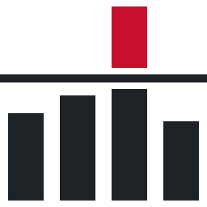
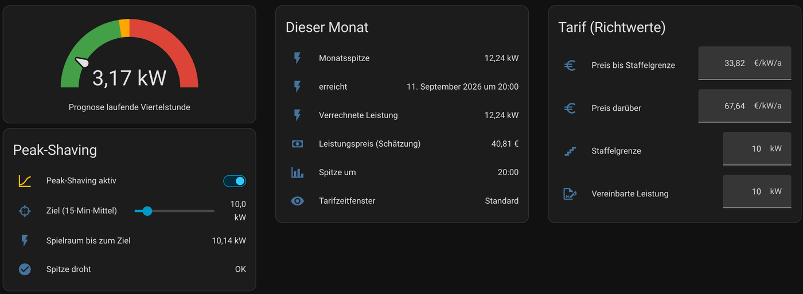
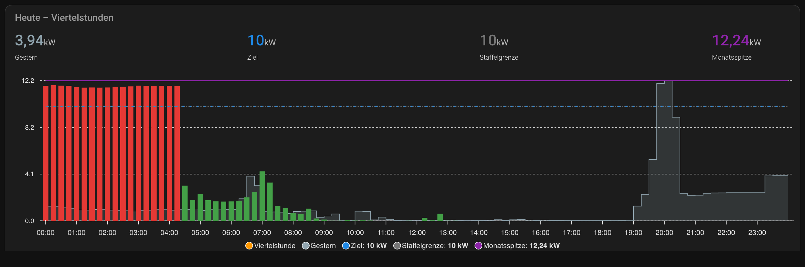
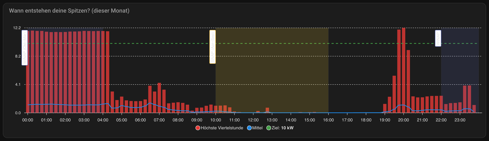
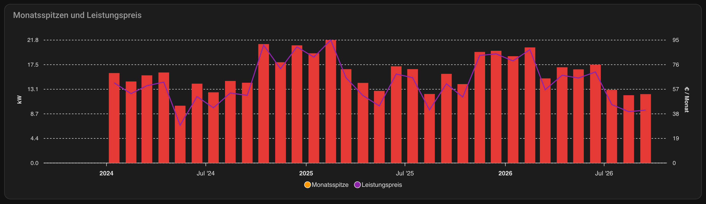
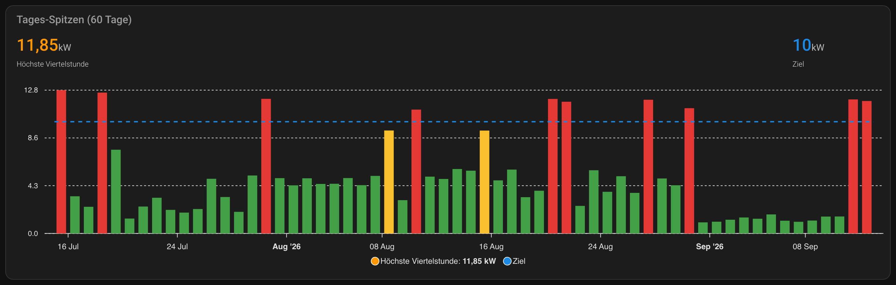
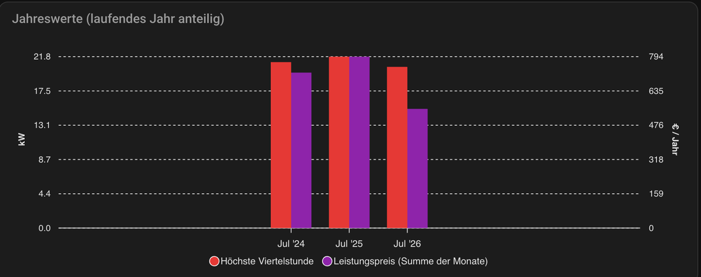
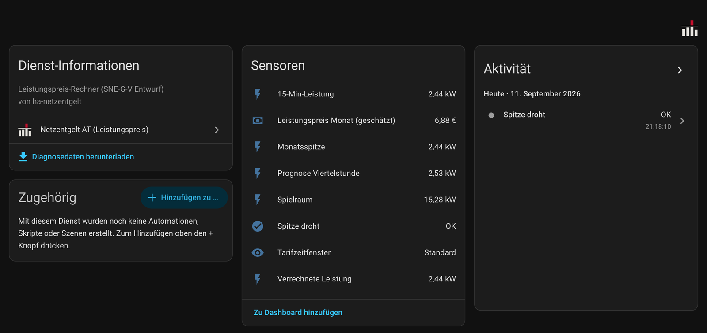

# Netzentgelt AT (Leistungspreis) für Home Assistant

Custom Integration für den **Leistungspreis** im österreichischen Netznutzungsentgelt ab 2027:
misst die 15-Minuten-Bezugsleistung wie der Netzbetreiber, führt die Monatsspitze, schätzt den
Leistungspreis und liefert mit **Prognose** und **Spielraum** die Grundlage für Peak-Shaving
(z. B. Wallbox drosseln). Ab v0.2: Ziel-Leistung per Schieberegler, Schalter „Peak-Shaving
aktiv“, Lastprofil (wann entstehen die Spitzen?), 36 Monate Verlauf mit Kosten, Import des
Portal-Exports deines Netzbetreibers, Blueprints und ein Grafik-Dashboard.

> **⚠️ Preise sind Richtwerte, 2027 gilt großteils eine Übergangsregel.** Grundlage ist die
> Systemnutzungsentgelte-Grundsatzverordnung (SNE-G-V), **BGBl. II Nr. 299/2026**, kundgemacht am
> 12.10.2026, in Kraft ab 1.1.2027. Die Preise legt die Tarifverordnung (SNE-T-V 2027) fest — sie
> liegt bisher nur als Begutachtungsentwurf vor (Stand 24.11.2026).
> Alle Werte dieser Integration sind eine **Näherung aus deinen eigenen Sensoren — maßgeblich ist
> ausschließlich der Zähler des Netzbetreibers.** Keine Rechts- oder Tarifberatung.

## Die Regel (SNE-G-V, BGBl. II Nr. 299/2026)

- Für den Leistungspreis zählt der **höchste Viertelstunden-Mittelwert der Bezugsleistung im
  Kalendermonat** (§ 3 Abs. 1). Viertelstunden sind uhrzeitgebunden (:00, :15, :30, :45); der
  Wert wird kaufmännisch auf 2 Nachkommastellen gerundet (§ 28 Abs. 2). Jeder Monat beginnt neu.
- **Netzebene 7 zweistufig** (§ 6 Abs. 2): ein Monatsleistungspreis für den Anteil bis 10 kW,
  ein höherer für den Anteil darüber.
- **Mindestverrechnung auf Netzebene 7: 2 kW** (§ 6 Abs. 3 Z 2). Die 20 % der vereinbarten
  Leistung aus dem Entwurf gelten nur auf den Netzebenen 1 bis 6.
- **Übergangsregel 1.1.–30.11.2027** (§ 6 Abs. 3a): Für Anschlüsse mit „nicht gemessener
  Leistung“ — in der Regel Haushaltsanschlüsse — wird der Leistungspreis als
  **Pauschale je Zählpunkt** festgelegt, für die übrigen auf Netzebene 7 als ein einheitlicher
  Preis je kW. **Solange die Pauschale gilt, ändert die Monatsspitze die Netzrechnung nicht.**
  Staffel und Mindestleistung greifen ab **1.12.2027**; der Stichtag kann je Netzbereich zwischen
  1.1.2027 und 30.6.2028 verschoben werden (§ 6 Abs. 3b). Was für deinen Anschluss gilt, sagt dein
  Netzbetreiber.
- **Zeitvariable Arbeitspreise** (§ 7): SNAP (Sommer-Nieder-Arbeitspreis) 1.4.–30.9. 10:00–16:00;
  WiNAP (Winter-Nieder-Arbeitspreis) 1.10.–31.3. **23:00–05:00**, erstmals ab **1.10.2027**
  (§ 32 Abs. 4). Beide nur für Anschlüsse mit Viertelstundenwerten (§ 7 Abs. 5).
- **Bestandsanschlüsse auf Netzebene 7** (§ 34 Abs. 1): Als Leistung des Anschlusses gilt der
  höchste Wert aus 10 kW, der Ende 2026 vereinbarten Leistung und dem **Mittel der zwei höchsten
  Monatsspitzen 2026** (ohne Messwerte aus 2026: jenen aus 2027). Die Integration zeigt diesen
  Wert aus ihrem Verlauf als Attribut `grandfathered_kw`.

Im Endsystem bestimmt also eine einzige Viertelstunde mit Wallbox + Herd + Wärmepumpe den
Leistungspreis für den ganzen Monat — genau hier setzt Peak-Shaving an. Bis zum Stichtag ist die
Zeit zum Messen, Einstellen und Ausprobieren.

## So sieht es aus









*Grafik-Dashboard aus [`examples/dashboard-apexcharts.yaml`](examples/dashboard-apexcharts.yaml)
(braucht die HACS-Karte apexcharts-card), echte Werte eines Haushalts: „Wann entstehen deine
Spitzen?“ zeigt das Monatsprofil über den Tag, darunter die Monatsspitzen seit 2024 — die Monate
vor der Installation stammen aus dem importierten Portal-Export des Netzbetreibers
(`netzentgelt.import_load_profile`). Ein Dashboard nur mit Core-Karten liegt in
[`examples/dashboard.yaml`](examples/dashboard.yaml).*





*Tages-Spitzen aus der Langzeitstatistik und Jahreswerte aus dem Monatsverlauf — beide ebenfalls
im Grafik-Dashboard. Das laufende Jahr zählt nur anteilig.*



*Geräteseite: Schalter und Ziel-Schieberegler unter „Steuerung“, die übrigen Einstellungen unter
„Konfiguration“, mit eigenem Icon (HA ≥ 2026.3).*

## Was die Integration ersetzt

Wer Peak-Shaving bisher mit einem YAML-Paket (Helfer, Template-Sensoren, eigene Automationen)
gebaut hat, braucht davon nichts mehr:

| Bisher im YAML-Paket | Mit der Integration |
|---|---|
| `input_number` für die kW-Grenze im Dashboard | `number.netzentgelt_ziel_leistung` — Schieberegler (0,5 kW bis zur Plausibilitätsgrenze, Standard 60 kW), wirkt sofort, ohne Neuladen |
| `input_boolean` „Peak-Shaving an/aus“ | `switch.netzentgelt_peak_shaving_aktiv` — Freigabe für Automationen, übersteht Neustarts |
| Template-Sensoren für Viertelstunde und Monatsspitze | 15-Min-Leistung und Monatsspitze mit Interpolation an der Grenze und Ungültig-Erkennung bei Messlücken |
| Monatsspitze nur für den laufenden Monat | Verlauf über 36 Monate mit verrechneter Leistung, Leistungspreis und Herkunft (gemessen/importiert) |
| Staffelgrenze, Preise, Hysterese fest im YAML | Einstellungs-Entities und Options-Dialog (eine Quelle, beide zeigen dasselbe) |
| eigene Automationen für Wallbox, Lastabwurf, Speicher, Push | vier Blueprints zum Importieren (siehe unten) |
| Diagramme aus der Recorder-Historie | Sensor „Lastprofil“ (heute, gestern, Monatsprofil) und fertiges Grafik-Dashboard |

## Was du brauchst

1. **Home Assistant 2026.3 oder neuer** (für die Installation über HACS zusätzlich HACS).
2. **Einen Energiesensor für den Netzbezug am Hausanschluss**, der laufend aktualisiert wird
   (Zählerstand in kWh, `total_increasing`; idealerweise jede Minute oder öfter, Lücken bis
   20 Minuten werden überbrückt). Woher der kommen kann, steht im nächsten Abschnitt.
3. *Optional:* einen Sensor für die aktuelle Bezugsleistung (W/kW) — macht Prognose und
   Spielraum reaktionsschneller.
4. *Für automatisches Peak-Shaving:* einen der Blueprints, eine eigene Automation oder dein
   Lademanagement. Die Integration **misst, rechnet und warnt nur, sie schaltet nichts** (siehe
   „Peak-Shaving mit Blueprints“). Wer [evcc](https://evcc.io) nutzt, kann den Netzbezug
   zusätzlich direkt über einen `circuit` mit `maxPower` begrenzen (z. B. 9500 W bei einer
   10-kW-Grenze).
5. *Für die Grafiken:* die HACS-Karte [apexcharts-card](https://github.com/RomRider/apexcharts-card)
   (nur für `examples/dashboard-apexcharts.yaml`).

## Smart Meter und Messdaten

**Der Leistungspreis wird am Smart Meter des Netzbetreibers gemessen.** Home Assistant kann nur
so gut rechnen wie die Daten, die es bekommt. Drei Wege, von am genauesten bis ungeeignet:

**1. Kundenschnittstelle des Smart Meters (am genauesten).** Österreichische Smart Meter haben
eine lokale Kundenschnittstelle (je nach Zählertyp optisch/Infrarot oder M-Bus). Sie liefert
Zählerstände und Leistung nahezu in Echtzeit — aus demselben Gerät, nach dem abgerechnet wird.
- Die Schnittstelle muss meist beim Netzbetreiber **freigeschaltet** werden; die Daten sind
  **AES-verschlüsselt**, den Schlüssel gibt es im Kundenportal des Netzbetreibers.
- Auslesen per Lesekopf bzw. M-Bus-Adapter, z. B. mit ESPHome oder einer eigenen Integration.
  Beispiele aus der Community (nicht von uns getestet):
  [Wiener Netze (ESPHome)](https://github.com/bernikr/esphome-wienernetze-smartmeter),
  [EVN, Salzburg Netz, TINETZ über M-Bus](https://github.com/NECH2004/smartmeter_austria),
  [Netz OÖ / AMIS (ESPHome, Forum)](https://community.home-assistant.io/t/amis-smart-meter-integration-with-esphome-upper-austria/313525).
- Welcher Zähler bei dir verbaut ist und wie die Freischaltung geht, steht beim jeweiligen
  Netzbetreiber.

**2. Eigener Zähler am Hausanschluss (gut).** Z. B. der Smart Meter des Wechselrichters
(Fronius, SMA, Huawei …) oder ein 3-Phasen-Energiezähler (z. B. Shelly Pro 3EM), sofern er den
**gesamten Bezug am Netzanschlusspunkt** misst. Messunterschiede zum Netzzähler sind normal —
bei unserem Test lag ein Fronius Smart Meter rund 0,5 % unter dem Netzzähler (siehe
„Genauigkeit“). Ziel deshalb mit Puffer setzen.

**3. Nicht geeignet:**
- **Verbrauch statt Bezug:** Bei PV-Anlagen ist der Hausverbrauch nicht der Netzbezug. Es zählt
  nur, was aus dem Netz kommt.
- **Unterzähler** einzelner Geräte (Wallbox, Wärmepumpe) — die Spitze entsteht am Hausanschluss.
- **Portaldaten des Netzbetreibers:** Die Viertelstundenwerte im Kundenportal kommen erst am
  Folgetag — für die Live-Steuerung zu spät, aber ideal zum Nachprüfen: Portal-Export und eigene
  Zählerstände mit `tools/replay.py` vergleichen (siehe „Entwicklung“), und zum Nachtragen der
  Monate vor der Installation (siehe „Lastgang importieren“).

**Viertelstundenwerte beim Netzbetreiber.** Seit dem ElWG (in Kraft seit 24.12.2025) erfassen
die Netzbetreiber standardmäßig Viertelstundenwerte; die Umstellung der Zähler läuft 2026
schrittweise. Haushalte können widersprechen — nicht aber, wenn z. B. eine Wärmepumpe,
Ladestation, ein Speicher oder eine Erzeugungsanlage angeschlossen ist, bei dynamischem
Stromtarif oder in einer Energiegemeinschaft. Laut Verordnung gelten die günstigeren
Zeitfenster SNAP und WiNAP nur für Anschlüsse mit Viertelstundenwerten (§ 7 Abs. 5); fehlt der
gemessene Höchstwert, wird er rechnerisch ermittelt (§ 3 Abs. 3). Details:
[Netz NÖ zum ElWG](https://netz-noe.at/energiezukunft/elwg-zu-smart-meter) bzw. dein
Netzbetreiber.

**Energiegemeinschaften:** Der Leistungspreis sinkt nur bei gemeinsamer Energienutzung über
gemeinschaftliche Leitungsanlagen (§ 9 Abs. 2, § 70 Abs. 6 Z 1 und 2 ElWG). Eine
Energiegemeinschaft über das öffentliche Netz senkt den Leistungspreis nicht — sie wirkt nur auf
den Arbeitspreis (§ 9 Abs. 3). Die Integration rechnet deshalb mit dem physischen Netzbezug.

## Installation

### HACS

Die Integration steht seit 19.10.2026 in der HACS-Standardliste.

1. HACS öffnen, nach **„Netzentgelt AT“** suchen, herunterladen.
2. Home Assistant neu starten.
3. Einstellungen → Geräte & Dienste → **Integration hinzufügen** → „Netzentgelt AT“.

Wer sie früher als benutzerdefiniertes Repository eingetragen hat, muss nichts ändern.

### Manuell

Ordner `custom_components/netzentgelt` nach `<config>/custom_components/netzentgelt` kopieren,
Home Assistant neu starten, Integration wie oben hinzufügen.

Mindestversion: Home Assistant 2026.3.

## Konfiguration

**Einrichtung (Config-Flow)**

| Feld | Pflicht | Beschreibung |
|---|---|---|
| Name | ja | Gerätename, bestimmt die Entity-IDs |
| Energie Netzbezug | ja | Zählerstand des **Bezugs** (device_class `energy`, state_class `total`/`total_increasing`, Einheit Wh/kWh/MWh — wird umgerechnet) |
| Leistung Netzbezug | nein | Aktueller Bezug in W oder kW. Verbessert Prognose und Spielraum. Negative Werte (Einspeisung) zählen als 0 |

Mehrere Einträge (z. B. mehrere Zählpunkte) sind möglich — je Energiesensor einer.

**Optionen** (Zahnrad am Eintrag oder direkt über die Einstellungs-Entities, siehe „Entities“).
Wert-Änderungen (Ziel, Staffel, vereinbarte Leistung, Mindestleistung, Preise, Hysterese, Stichtag) werden
**sofort übernommen, ohne die Integration neu zu laden** — die laufende Viertelstunde bleibt
gültig. Nur eine Änderung der Plausibilitätsgrenze lädt neu.

| Option | Standard | Bedeutung |
|---|---|---|
| Ziel-Leistung | 10 kW | Peak-Shaving-Ziel für den 15-Min-Mittelwert (Prognose, Spielraum, „Spitze droht“) |
| Staffelgrenze | 10 kW | bis einschließlich: Stufe 1, darüber Stufe 2 |
| Vereinbarte Leistung | 10 kW | vertraglich vereinbarte Leistung. Geht **nicht** in den monatlichen Leistungspreis ein, nur in `grandfathered_kw` (§ 34) |
| Mindestleistung | 2 kW | untere Grenze der Verrechnung (Netzebene 7: 2 kW) |
| Leistungspreis Stufe 1 | 30,42 €/kW/Jahr | **Richtwert**: Median der 14 Netzbereiche im Begutachtungsentwurf der SNE-T-V 2027. Wert deines Netzbereichs aus der Tabelle unten eintragen |
| Leistungspreis Stufe 2 | 45,66 €/kW/Jahr | **Richtwert** (dto.) |
| Arbeitspreis Standard / SNAP / WiNAP | 0 ct/kWh | 0 = nicht gesetzt; nur zur Anzeige im Tarifzeitfenster |
| Plausibilitätsgrenze | 60 kW | Viertelstunden darüber gelten als Messfehler |
| Hysterese | 0,2 kW | „Spitze droht“ geht erst unter *Ziel − Hysterese* wieder aus |
| Monatsspitze wird verrechnet ab | 1.12.2027 | Stichtag, ab dem der Leistungspreis nach der Monatsspitze verrechnet wird (Ende der Übergangsregel). Nur im Options-Dialog. Davor sind die Kosten eine Vorschau (`billing_active: false`) |

Bestehende Installationen behalten ihre eingestellten Preise; die neuen Standardwerte gelten nur
für neu angelegte Einträge.

### Preise je Netzbereich (Begutachtungsentwurf SNE-T-V 2027)

**Entwurf, nicht kundgemacht** — abgeschrieben aus dem Begutachtungsentwurf der E-Control
(§ 5 Abs. 1 und 2, Netzebene 7), ohne Umsatzsteuer. Die Verordnung setzt den Leistungspreis als
**Monatswert in Cent/kW** fest; die Integration rechnet in €/kW/Jahr (Monatswert × 12 / 100).
Die endgültigen Werte können abweichen.

| Netzbereich | Stufe 1 bis 10 kW (€/kW/Jahr) | Stufe 2 über 10 kW (€/kW/Jahr) | Arbeitspreis (ct/kWh) | SNAP / WiNAP (ct/kWh) | Übergang, nicht gemessen: Arbeitspreis / SNAP (ct/kWh) | Übergang, gemessen: Leistungspreis (€/kW/Jahr) |
|---|---|---|---|---|---|---|
| Burgenland | 40,80 | 61,20 | 6,60 | 5,28 | 8,44 / 6,75 | 76,56 |
| Kärnten | 42,12 | 63,24 | 7,83 | 6,26 | 10,58 / 8,46 | 119,04 |
| Klagenfurt | 30,00 | 45,00 | 5,70 | 4,56 | 6,28 / 5,02 | 88,44 |
| Niederösterreich | 31,32 | 47,04 | 6,11 | 4,89 | 7,53 / 6,02 | 50,40 |
| Oberösterreich | 28,92 | 43,44 | 5,41 | 4,33 | 6,44 / 5,15 | 53,64 |
| Linz | 30,84 | 46,32 | 5,28 | 4,22 | 5,98 / 4,78 | 69,00 |
| Salzburg | 25,20 | 37,80 | 5,19 | 4,15 | 6,42 / 5,14 | 70,08 |
| Steiermark | 38,52 | 57,84 | 6,59 | 5,27 | 8,31 / 6,65 | 65,64 |
| Graz | 27,36 | 41,04 | 5,17 | 4,14 | 5,40 / 4,32 | 48,60 |
| Tirol | 29,40 | 44,16 | 4,98 | 3,98 | 6,68 / 5,34 | 69,84 |
| Innsbruck | 39,12 | 58,68 | 6,74 | 5,39 | 8,32 / 6,66 | 87,12 |
| Vorarlberg | 24,00 | 36,00 | 3,77 | 3,02 | 4,20 / 3,36 | 57,72 |
| Wien | 29,52 | 44,28 | 5,58 | 4,46 | 6,61 / 5,29 | 79,56 |
| Kleinwalsertal | 69,96 | 105,00 | 11,10 | 8,88 | 16,67 / 13,34 | 171,72 |

- **Übergang, nicht gemessene Leistung:** in allen Netzbereichen eine Pauschale von 82,80 €/Jahr
  je Zählpunkt statt eines Leistungspreises nach Spitze.
- **Übergang, gemessene Leistung:** ein einheitlicher Leistungspreis ohne Staffel — dafür Stufe 1
  und Stufe 2 auf denselben Wert setzen und den Stichtag auf den 1.1.2027.
- Bis wann der Übergang im jeweiligen Netzbereich gilt, lässt der Entwurf offen („XXX“).

## Entities

Entity-IDs entstehen aus Gerätename und Entity-Name in der Systemsprache (Beispiele: Gerät
„Netzentgelt“, Deutsch).

| Entity | Beispiel-ID | Inhalt |
|---|---|---|
| 15-Min-Leistung | `sensor.netzentgelt_15_min_leistung` | Mittelwert der zuletzt abgeschlossenen **gültigen** Viertelstunde (kW). Attribute: `quarter_start/_end`, `energy_kwh`, `last_quarter_start`, `last_quarter_valid`, `last_quarter_reason`, `invalid_quarters_month` |
| Prognose Viertelstunde | `sensor.netzentgelt_prognose_viertelstunde` | (verbraucht seit Grenze + P_jetzt × Restzeit) × 4, alle 30 s |
| Monatsspitze | `sensor.netzentgelt_monatsspitze` | höchste gültige Viertelstunde im Kalendermonat (eigene Messung und ggf. importierter Lastgang). Attribute: `peak_quarter_start/_end`, `peak_rounded_kw`, `valid_quarters_month`, `invalid_quarters_month`, `source`, `history` (bis 36 Monate: Monat → `peak_kw`, `peak_start`, `valid_quarters`, `invalid_quarters`, `imported_quarters`, `billed_kw`, `capacity_cost_eur` — mit den **aktuellen** Preiseinstellungen gerechnet —, `source` = `measured`/`imported`/`mixed`; wird nicht in den Recorder geschrieben) |
| Verrechnete Leistung | `sensor.netzentgelt_verrechnete_leistung` | max(Monatsspitze kaufmännisch gerundet, Mindestleistung). Attribute: `peak_rounded_kw`, `minimum_kw`, `agreed_kw`, `basis`, dazu `grandfathered_kw` (Leistung des Bestandsanschlusses nach § 34 Abs. 1), `grandfathered_year` (2026 oder 2027) und `grandfathered_months` (1 = erst ein Monat im Verlauf, Näherung) |
| Leistungspreis Monat (geschätzt) | `sensor.netzentgelt_leistungspreis_monat_geschatzt` | (Stufe 1 bis Staffelgrenze + Stufe 2 darüber) / 12, in €. Attribute u. a. `billing_start` (Stichtag) und `billing_active` — `false` heißt: Übergangsregel, der Wert ist eine Vorschau auf das Endsystem |
| Spielraum | `sensor.netzentgelt_spielraum` | zusätzliche **konstante** Last (kW), die bis Viertelstundenende noch dazukommen darf, ohne das Ziel zu reißen; **negativ = drosseln** |
| Tarifzeitfenster | `sensor.netzentgelt_tarifzeitfenster` | `snap` / `winap` / `standard`; `winap` erstmals ab 1.10.2027. Attribute `window_end`, `energy_price_ct_kwh` (falls gesetzt) |
| Spitze droht | `binary_sensor.netzentgelt_spitze_droht` | ein, wenn Prognose > Ziel; aus erst unter Ziel − Hysterese |
| Lastprofil | `sensor.netzentgelt_lastprofil` | Uhrzeit (HH:MM) der Viertelstunde mit der Monatsspitze. Attribute (nicht im Recorder): `today_kw`, `yesterday_kw` (je 96 Werte, Index = Viertelstunde des Tages, `null` = fehlend/ungültig), `month_max_kw`, `month_avg_kw` (höchster bzw. mittlerer Wert je Uhrzeit im laufenden Monat), `labels` (96 × `HH:MM`), `month` |
| Peak-Shaving aktiv | `switch.netzentgelt_peak_shaving_aktiv` | Freigabe für Automationen und Blueprints (Standard: aus, Zustand übersteht Neustarts). Die Integration selbst schaltet nichts |
| Ziel-Leistung | `number.netzentgelt_ziel_leistung` | Schieberegler 0,5 kW bis Plausibilitätsgrenze (Standard 60 kW), Schritt 0,1 |
| Einstellungen | `number.netzentgelt_staffelgrenze`, `…_vereinbarte_leistung`, `…_mindestleistung`, `…_leistungspreis_stufe_1`, `…_leistungspreis_stufe_2`, `…_hysterese` | Kategorie „Konfiguration“ auf der Geräteseite; dieselben Werte wie im Options-Dialog |

Spielraum = ((Ziel / 4 − verbraucht_kWh) / Rest_h) − P_jetzt; die Restzeit wird auf mindestens
30 s begrenzt. P_jetzt kommt aus dem Leistungssensor, sonst aus der Steigung der letzten
Zählerstände (≈ 2 min), sonst aus dem Mittel der laufenden Viertelstunde (Attribut `power_source`).

Einstellungs-Entities schreiben in die Optionen des Eintrags (eine einzige Quelle). Die Regeln des
Options-Dialogs gelten auch hier: Hysterese kleiner als das Ziel, Ziel höchstens
Plausibilitätsgrenze — sonst lehnt Home Assistant den Wert mit einer Meldung ab.

**Lastprofil und Zeitumstellung:** Die Zuordnung erfolgt über die lokale Uhrzeit. Am Tag der
Umstellung auf Winterzeit gibt es 02:00–02:59 zweimal: im Tagesprofil zählt der höhere Wert, im
Monatsmittel gehen beide ein. Am Tag der Umstellung auf Sommerzeit bleiben 02:00–02:45 leer.
Heute/gestern und das Monatsprofil liegen im HA-Speicher und überstehen Neustarts; beim
Monatswechsel wird das Monatsprofil mit dem Verlauf archiviert.

## Messprinzip und Verhalten bei Messlücken

Das Vorbild (ein YAML-Paket) nahm an jeder Viertelstundengrenze einfach den aktuellen Zählerstand
— war der Zähler gerade `unavailable`, wurde daraus 0, und die nächste Differenz ergab eine
„Spitze“ von über 270 000 kW. Diese Integration rechnet deshalb so:

1. **Samples:** Jeder gemeldete Zählerstand wird mit Zeitstempel gesammelt — auch unveränderte
   Werte (HA-Ereignis `state_reported`), damit ein stehender Zähler nicht als Lücke gilt.
2. **Interpolation an der Grenze:** Der Zählerstand um :00/:15/:30/:45 wird **linear
   interpoliert** aus dem letzten gültigen Sample davor und dem ersten danach. Damit ist die
   Poll-Latenz der Quelle ausgeglichen. Die Viertelstunde wird deshalb erst ausgewertet, sobald
   das erste Sample *nach* der Grenze eingetroffen ist (bei pollenden Zählern nach Sekunden).
3. **Ungültig statt raten:** Eine Viertelstunde ist ungültig, wenn
   - die beiden Samples um eine Grenze mehr als **20 min** auseinanderliegen *und* der Zähler
     dazwischen um mehr als 0,01 kWh gestiegen ist (bei höchstens 0,01 kWh ist der interpolierte
     Stand auf 0,01 kWh genau — Fehler der Viertelstunde ≤ 0,04 kW; typisch für Zähler, die nur bei
     Änderung melden, bei nahezu null Bezug),
   - die Quelle zwischendurch `unavailable`/`unknown`/nicht numerisch war oder die Einheit fehlt,
   - der Zähler **fällt** (Reset, Zählertausch) oder unplausibel springt,
   - die Leistung über der **Plausibilitätsgrenze** liegt,
   - nach dem Start von Home Assistant bzw. einem Neuladen der Integration die Startgrenze nicht
     beobachtet wurde (die laufende Viertelstunde ist dann ungültig),
   - binnen 3 h nach der Grenze kein Sample mehr kam.
4. **Ungültige Viertelstunden erzeugen keinen Wert.** Der Sensor *15-Min-Leistung* behält den
   letzten gültigen Wert (die Attribute `quarter_start`/`quarter_end` sagen, zu welcher
   Viertelstunde er gehört) und meldet über `last_quarter_valid: false` und
   `last_quarter_reason`, dass die jüngste Viertelstunde verworfen wurde. Ungültige
   Viertelstunden gehen **nie** in die Monatsspitze ein und werden in `invalid_quarters_month`
   gezählt. Bewusst gewählt: Ein Sprung auf `unknown` würde Automationen und Statistiken
   stören, ein erfundener Wert wäre schlimmer als keiner.
5. **Monatszuordnung** über den **Beginn** des Intervalls in Ortszeit (HA-Zeitzone):
   23:45–00:00 am Monatsletzten gehört zum alten Monat, 00:00–00:15 zum neuen — auch wenn die
   23:45-Viertelstunde erst nach Mitternacht fertig ausgewertet wird.
6. Monatsspitzen, Verlauf (36 Monate) und Lastprofile werden im HA-Speicher
   (`.storage/netzentgelt.<id>`) abgelegt und überstehen Neustarts.

**WiNAP-Auslegung:** Das Fenster 23:00–05:00 reicht über Mitternacht. § 7 Abs. 4 nennt den
Zeitraum „von 1. Oktober bis 31. März des Folgejahres jeweils von 23 Uhr bis 5 Uhr des
Folgetags“; die Integration ordnet eine Nacht deshalb dem Tag zu, an dem sie **beginnt**. Die
Nacht 31.3.→1.4. ist bis 05:00 noch WiNAP, die Nacht 30.9.→1.10. ist es nicht. Die erste
WiNAP-Nacht überhaupt beginnt am 1.10.2027 um 23:00 (§ 32 Abs. 4) — im Winter 2026/27 meldet
der Sensor nachts `standard`.

## Peak-Shaving mit Blueprints

Vier Automations-Blueprints (Ordner [`blueprints/automation/netzentgelt/`](blueprints/automation/netzentgelt/)).
Import per Button (öffnet deine Home-Assistant-Instanz) oder unter Einstellungen → Automationen →
Blueprints → „Blueprint importieren“ mit der Datei-URL. **Alle laufen nur, solange
„Peak-Shaving aktiv“ eingeschaltet ist** (Benachrichtigungen ausgenommen). Im Testharness von
Home Assistant ausgeführt, **nicht an einer echten Wallbox** — zuerst in der Ablaufverfolgung
beobachten.

| Blueprint | Was er tut | Import |
|---|---|---|
| **Wallbox am Spielraum ausrichten** (`wallbox_spielraum.yaml`) | Stellt den Ladestrom einer `number`-Entity (A) so ein, dass der Spielraum aufgebraucht, aber nicht überschritten wird: Phasen, Spannung, Min-/Höchststrom, Totband. Reicht selbst der Mindeststrom nicht, schaltet er optional einen Freigabe-Schalter der Wallbox aus und wieder ein, sobald Platz ist (spätestens nach 30 min). Beim Ausschalten von Peak-Shaving optional zurück auf Höchststrom. | [](https://my.home-assistant.io/redirect/blueprint_import/?blueprint_url=https%3A%2F%2Fraw.githubusercontent.com%2Fneuhubereco%2Fha-netzentgelt%2Fmain%2Fblueprints%2Fautomation%2Fnetzentgelt%2Fwallbox_spielraum.yaml) |
| **Lasten abwerfen** (`last_abwerfen.yaml`) | Schaltet gewählte Schalter/Input-Booleans aus, wenn „Spitze droht“ einschaltet, und nach dem Ende plus Wartezeit **nur die wieder ein, die er selbst ausgeschaltet hat** (optional erst zur nächsten Viertelstunde; sofort, wenn Peak-Shaving ausgeschaltet wird; spätestens nach der Höchstdauer). Optional mit **geschützter Last**: läuft die (Sauna, Herd, Backofen), weichen die anderen Lasten sofort und kommen erst zurück, wenn sie fertig ist. | [](https://my.home-assistant.io/redirect/blueprint_import/?blueprint_url=https%3A%2F%2Fraw.githubusercontent.com%2Fneuhubereco%2Fha-netzentgelt%2Fmain%2Fblueprints%2Fautomation%2Fnetzentgelt%2Flast_abwerfen.yaml) |
| **Benachrichtigung** (`benachrichtigung.yaml`) | Push bei „Spitze droht“ mit Prognose und Spielraum (höchstens einmal je Drosselzeit) und bei neuer Monatsspitze über der Staffelgrenze (danach je weiterer Stufe, z. B. alle 0,5 kW; nicht nach Neustart/Neuladen). Aktion frei wählbar, z. B. `notify.mobile_app_mein_handy`. | [](https://my.home-assistant.io/redirect/blueprint_import/?blueprint_url=https%3A%2F%2Fraw.githubusercontent.com%2Fneuhubereco%2Fha-netzentgelt%2Fmain%2Fblueprints%2Fautomation%2Fnetzentgelt%2Fbenachrichtigung.yaml) |
| **Hausspeicher reservieren** (`speicher_reserve.yaml`) | Hält im Speicher eine Reserve für Netzspitzen frei und gibt sie erst bei „Spitze droht“ aus: Mindestreserve = Notstrom + Peak, während der Spitze nur Notstrom. Optional wird die Netzladung des Speichers währenddessen abgeschaltet und danach in den vorherigen Zustand zurückgestellt. Für Wechselrichter, deren Mindestreserve als `number`-Entity verfügbar ist (z. B. Fronius GEN24); mit Keepalive-Option für Modbus-Steuerungen mit Verfallszeit. | [](https://my.home-assistant.io/redirect/blueprint_import/?blueprint_url=https%3A%2F%2Fraw.githubusercontent.com%2Fneuhubereco%2Fha-netzentgelt%2Fmain%2Fblueprints%2Fautomation%2Fnetzentgelt%2Fspeicher_reserve.yaml) |

Wer [evcc](https://evcc.io) nutzt, kann statt des Wallbox-Blueprints auch dort einen `circuit` mit
`maxPower` setzen. Wärmepumpen besser nur begrenzen, nicht hart abschalten.

<details>
<summary>Eigene Automation ohne Blueprint (Minimalbeispiel Wallbox)</summary>

`number.wallbox_ladestrom` durch die eigene Ladestrom-Entity ersetzen und an Phasenzahl/Mindeststrom
anpassen.

```yaml
automation:
  - alias: "Netzentgelt: Wallbox an Spielraum anpassen"
    mode: single
    triggers:
      - trigger: state
        entity_id: sensor.netzentgelt_spielraum
    conditions:
      - condition: template
        value_template: >
          {{ states('sensor.netzentgelt_spielraum') | is_number
             and states('number.wallbox_ladestrom') | is_number }}
    actions:
      - variables:
          # 3-phasig, 230 V: 1 A ≈ 0,69 kW
          kw_pro_ampere: 0.69
          aktuell_a: "{{ states('number.wallbox_ladestrom') | float }}"
          spielraum_kw: "{{ states('sensor.netzentgelt_spielraum') | float }}"
          ziel_a: >
            {{ [[(aktuell_a + spielraum_kw / kw_pro_ampere) | round(0, 'floor'), 6] | max, 16] | min }}
      - condition: template
        value_template: "{{ (ziel_a - aktuell_a) | abs >= 1 }}"
      - action: number.set_value
        target:
          entity_id: number.wallbox_ladestrom
        data:
          value: "{{ ziel_a }}"
```

</details>

## Lastgang importieren (Portal-Export deines Netzbetreibers)

Die Viertelstundenwerte aus dem Kundenportal des Netzbetreibers lassen sich einlesen — damit sind
Monatsspitzen, Kosten und Lastprofil auch für die Zeit **vor** der Installation da, und die
Langzeitstatistik der 15-Min-Leistung reicht weiter zurück.

1. Im Portal den Viertelstunden-Lastgang (Bezug) als CSV exportieren.
2. Datei ins Home-Assistant-Konfigurationsverzeichnis legen, z. B. `/config/netzentgelt/lastgang.csv`
   (File-Editor-, Samba- oder Studio-Code-Server-Add-on). **Nicht nach `/config/www`** — dieser
   Ordner ist ohne Anmeldung über `/local/` erreichbar.
3. Entwicklerwerkzeuge → Aktionen → **„Lastgang importieren“** (Netzentgelt AT), Eintrag und
   Datei wählen, ausführen. Die Antwort zeigt, was übernommen wurde. In Skripten mit
   `response_variable`:

```yaml
action: netzentgelt.import_load_profile
data:
  config_entry_id: DEINE_EINTRAGS_ID   # in der UI per Auswahlliste
  path: netzentgelt/lastgang.csv       # relativ zum Konfigurationsverzeichnis
  timestamp_is_end: false              # true, wenn der Zeitstempel das Ende der Viertelstunde ist
  overwrite: false                     # true: Monate mit eigener Messung durch den Import ersetzen
  import_statistics: true              # Stundenwerte in die Langzeitstatistik der 15-Min-Leistung
response_variable: ergebnis
```

**Dateiformat.** CSV mit `;`, `,` oder Tabulator, Kopfzeile optional, UTF-8 (auch mit BOM) oder
Windows-1252, Dezimalkomma oder -punkt. Zeitstempel `TT.MM.JJJJ HH:MM` (Ortszeit der
HA-Zeitzone; bei der Umstellung auf Winterzeit darf 02:00–02:45 zweimal vorkommen) oder ISO 8601
— in einer Spalte oder getrennt als **Datum + Uhrzeit** (`Datum;Zeit von;Zeit bis;kWh`: es gilt
die erste Uhrzeit nach dem Datum). Auf- oder absteigend sortiert (neueste Zeile zuerst geht auch).
Wertspalte: eine Spalte **kW** wird als Leistung genommen, sonst **kWh** × 4; weitere Spalten
(Status) werden ignoriert. Ohne Kopfzeile: zwei Zahlenspalten im Verhältnis 1 : 4 gelten als
kWh/kW, eine einzelne Zahlenspalte als kWh (Antwortfeld `value_column_source: assumed`).
**Komma als Trennzeichen und Dezimalkomma zugleich** (`2026-08-01 00:00,0,5`) ist nicht eindeutig
und wird mit einer Fehlermeldung abgelehnt — dann mit `;` exportieren oder die Werte in
Anführungszeichen setzen. Beispiele (Zeitstempel = Beginn):

```text
"Datum";"kWh";"kW";"Status";
"01.01.2026 00:00";0,354;1,416;"VALID";
```

```text
Datum;Zeit von;Zeit bis;kWh
01.01.2026;00:00;00:15;0,354
```

**Was passiert.**
- Monate **ohne** eigene Messung werden übernommen (`source: imported`).
- Monate **mit** eigener Messung: Spitze = Maximum aus beidem (`source: mixed`). Mit
  `overwrite: true` ersetzt der Import die eigene Messung eines Monats **nur, wenn alle eigenen
  Viertelstunden dieses Monats im importierten Zeitraum liegen** — sonst wird zusammengeführt
  (Antwortfeld `months_overwrite_skipped`). Der laufende Monat wird so nie durch einen kürzeren
  Import gelöscht.
- **Mehrere Dateien ergänzen sich:** Die importierten Viertelstunden werden je Monat vereinigt
  (eigener Speicher `.storage/netzentgelt.<eintrag>.import`); kommt eine Viertelstunde erneut
  vor, gilt der neuere Wert. Beispiel: erst 15.07.–14.08., dann 15.08.–03.09. → der August enthält
  beide Teile (`months_import_extended`, ersetzte Werte in `import_quarters_replaced`). Ein
  erneuter Import derselben Datei ändert nichts.
- Übersprungen: Monate älter als 36 Monate oder nach dem laufenden Monat.
- Heute/gestern im Lastprofil: nur Viertelstunden ohne eigenen Wert werden gefüllt (an der
  doppelten Stunde im Oktober der größere Wert).
- **Langzeitstatistik:** stündliche Mittel-/Min-/Maximalwerte als Statistik von
  `sensor.netzentgelt_15_min_leistung` — **nur für Stunden vor der ersten vorhandenen
  Statistik-Stunde dieses Sensors und vor seiner Anlage**, eigene Messwerte werden nie
  überschrieben.

**Antwort** (Felder): `rows`, `rows_skipped`, `duplicates`, `quarters`, `value_column`,
`value_column_source`, `period_start`, `period_end`, `months`, `months_imported`, `months_merged`,
`months_overwritten`, `months_overwrite_skipped`, `months_skipped`, `months_import_extended`,
`import_quarters_replaced`, `day_slots_filled`, `statistics_hours`, `statistics_hours_skipped`,
`statistics_until`, `statistics_note`.

**Sicherheit.** Nur Administratoren dürfen die Aktion ausführen. Erlaubt sind `.csv`/`.txt` bis
20 MB im Konfigurationsverzeichnis, ohne versteckte Ordner (z. B. `.storage`); `..` und Symlinks
nach außen werden abgelehnt. Dateien außerhalb nur in Verzeichnissen aus
[`allowlist_external_dirs`](https://www.home-assistant.io/integrations/homeassistant/#allowlist_external_dirs).

## Dashboards

- [`examples/dashboard.yaml`](examples/dashboard.yaml) — nur Standardkarten: Tacho, Ziel-Schieberegler,
  Schalter, Monatswerte, Verlauf.
- [`examples/dashboard-apexcharts.yaml`](examples/dashboard-apexcharts.yaml) — Grafiken mit der
  HACS-Karte [apexcharts-card](https://github.com/RomRider/apexcharts-card) (v2.2.x):
  **Heute** (96 Viertelstunden, grün/gelb/rot, Ziel, Staffelgrenze und Monatsspitze als Linien),
  **Wann entstehen deine Spitzen?** (Monatsprofil Maximum/Mittel mit SNAP-/WiNAP-Bändern),
  **Monatsspitzen** der letzten 36 Monate mit Leistungspreis, **Prognose** als Ring mit Ziel und
  **Spielraum**. Die Farbschwellen der Karte sind feste Zahlen (für Ziel 10 kW) — Hinweise im
  Kopf der Datei.

Beide in einem Dashboard über ⋮ → „Rohkonfiguration bearbeiten“ einfügen (oder nur die Karten).
Die Konfiguration ist gegen das Konfigurationsschema der Karte geprüft; die Darstellung selbst
hängt von Kartenversion und Theme ab.

## Genauigkeit und Grenzen

**Nachgeprüft mit echten Daten:** Sieben Wochen Zählerstände eines Haushalts (Mai/Juni 2026,
Fronius Smart Meter über Home Assistant, ~35.500 Werte) wurden durch die Rechenlogik gespielt und
mit dem Viertelstunden-Lastgang des Netzbetreibers verglichen (4.473 Viertelstunden):
mittlere Abweichung **0,008 kW**, 95 % der Viertelstunden unter 0,033 kW, größte Abweichung
0,25 kW. Die Monatsspitze lag in beiden Monaten auf **derselben Viertelstunde** wie beim
Netzbetreiber, aber rund **0,5 % niedriger** (16,54 statt 16,64 kW, 17,41 statt 17,47 kW) — der
Hauszähler misst etwas anders als der Netzzähler. **Deshalb das Ziel mit Puffer setzen**
(z. B. 9,5 kW, wenn 10 kW die Grenze ist). Rund 3 % der Viertelstunden waren wegen Datenlücken
(Neustarts, fehlende Werte) ungültig. Das Skript dafür liegt unter `tools/replay.py`.

- Die Werte sind nur so gut wie der Quellsensor. Zeitstempel ist der Moment, in dem Home
  Assistant den Wert erhält; Verzögerungen im Quellgerät selbst bleiben unsichtbar.
- Innerhalb einer Poll-Periode wird konstante Leistung angenommen (Interpolation). Springt die
  Last genau an der Grenze, verschiebt sich ein kleiner Anteil zwischen den Viertelstunden.
- Flexible Entnahme (§ 10) und die Leistungssaldierung bei gemeinschaftlichen Leitungsanlagen
  (§ 9 Abs. 2) sind nicht abgebildet.
- Die Übergangspauschale und der einheitliche Übergangspreis werden nicht als eigene Kosten
  gerechnet; die Integration zeigt bis zum Stichtag eine Vorschau auf das Endsystem.
- `grandfathered_kw` stammt aus dem eigenen Verlauf (Messung und Import). Maßgeblich sind die
  Werte des Netzbetreibers; für das ganze Jahr 2026 den Portal-Export importieren.
- Keine aktive Steuerung: Die Integration misst und rechnet nur. Schalten ist Sache eigener
  Automationen.

## Quellen

- Systemnutzungsentgelte-Grundsatzverordnung (SNE-G-V),
  [BGBl. II Nr. 299/2026](https://www.ris.bka.gv.at/eli/bgbl/II/2026/299/20261012), kundgemacht
  am 12.10.2026 — insbesondere § 3 (Monatsspitze), § 6 (Leistungspreis, Staffel,
  Mindestleistung, Übergangsregel), § 7 (SNAP/WiNAP), § 9 (Energiegemeinschaften), § 28
  (Rundung), § 32 (Inkrafttreten, WiNAP ab 1.10.2027), § 34 (Bestandsanschlüsse).
- Preise: Begutachtungsentwurf der Systemnutzungsentgelte-Tarife-Verordnung 2027 (SNE-T-V 2027),
  [E-Control](https://www.e-control.at/documents/d/guest/snt-v-2027-begutachtungsentwurf-pdf),
  gelesen am 24.11.2026 — **Entwurf**, im Bundesgesetzblatt bis dahin nicht kundgemacht.

## Entwicklung

```bash
uv venv -p 3.14 .venv
uv pip install --python .venv/bin/python -r requirements_test.txt
.venv/bin/python -m pytest -q
```

Die Rechenlogik (`custom_components/netzentgelt/calc.py`: Messung, Tarif, Lastprofil, Parser und
Merge des Lastgang-Imports) hat keine Home-Assistant-Abhängigkeit; `tests/test_calc.py` und
`tests/test_calc_profile.py` laufen auch mit reinem `pytest`. Die übrigen Tests nutzen
pytest-homeassistant-custom-component (simulierte HA-Instanz, für den Statistik-Import mit
Recorder auf In-Memory-SQLite; die Blueprints werden dort als Automationen ausgeführt).

Eigene Daten gegen den Netzbetreiber-Lastgang prüfen:

```bash
python3 tools/replay.py zaehler.csv --reference lastgang.csv
# zaehler.csv:  ISO-Zeitstempel,kWh   (z. B. InfluxDB-Export des Energiesensors)
# lastgang.csv: TT.MM.JJJJ HH:MM;kWh;kW  (Portal-Export, Zeitstempel = Beginn der Viertelstunde)
```

## Changelog

### 0.2.2

Angleichung an die **kundgemachte** Grundsatzverordnung (SNE-G-V, BGBl. II Nr. 299/2026); bisher
rechnete die Integration nach dem Begutachtungsentwurf.

- **WiNAP 23:00–05:00 statt 22:00–04:00, und erst ab 1.10.2027.** Im Winter 2026/27 meldet
  `sensor.netzentgelt_tarifzeitfenster` nachts `standard` (bisher fälschlich `winap`).
  Automationen, die auf `winap` schalten, greifen damit erst ab Oktober 2027.
- **Mindestverrechnung: 2 kW** auf Netzebene 7. Die 20 % der vereinbarten Leistung entfallen.
  Wer eine vereinbarte Leistung über 10 kW eingetragen hat, sieht in Monaten mit sehr kleiner
  Spitze eine niedrigere verrechnete Leistung als bisher. Das Attribut `minimum_share` gibt es
  nicht mehr.
- **Übergangsregel:** neue Option „Monatsspitze wird verrechnet ab“ (Standard 1.12.2027) und
  Attribute `billing_start` / `billing_active` am Leistungspreis-Sensor. Bis zum Stichtag ist der
  Leistungspreis eine Vorschau auf das Endsystem.
- **Bestandsanschluss (§ 34):** Attribute `grandfathered_kw`, `grandfathered_year`,
  `grandfathered_months` an der verrechneten Leistung — höchster Wert aus 10 kW, vereinbarter
  Leistung und dem Mittel der zwei höchsten Monatsspitzen 2026.
- **Standardpreise 30,42 / 45,66 €/kW/Jahr** (Median des Begutachtungsentwurfs der SNE-T-V 2027)
  statt 33,82 / 67,64. Gilt nur für neue Einträge; im README steht die Tabelle je Netzbereich.
- **Beispiel-Dashboards:** WiNAP-Band auf 23–05 Uhr.
- **Installation:** HACS-Standardliste statt benutzerdefiniertem Repository.
- **Grafik-Dashboard für englische Installationen:** `examples/dashboard-apexcharts.en.yaml` mit den
  Entity-IDs, die HA bei Systemsprache Englisch anlegt, und englischen Beschriftungen. Die IDs
  stammen aus einem Community-Beitrag ([@babajun12](https://github.com/babajun12), Issue #3); ein
  Test prüft sie jetzt gegen eine echte englische Installation.
- **Behoben:** Attribut-Zeilen in den Beispiel-Dashboards verwendeten `format:` — Home Assistant kennt
  dort nur `time_format:`, der Zeitpunkt der Monatsspitze wurde deshalb unformatiert angezeigt.
  Ebenfalls aus Issue #3.

### 0.2.1

- **Blueprint „Hausspeicher reservieren" (neu):** Notstrom- und Peak-Reserve im Speicher trennen,
  die Peak-Reserve nur bei drohender Spitze ausgeben, optional die Netzladung des Speichers
  währenddessen abschalten.
- **Blueprint „Lasten abwerfen" kennt eine geschützte Last:** einen Verbraucher, den man nicht
  unterbrechen will (Sauna, Herd, Backofen). Läuft er, weichen die anderen Lasten sofort statt auf
  die drohende Spitze zu warten, und kommen erst zurück, wenn er fertig ist. Ein 9-kW-Saunaofen
  reißt ein 10-kW-Ziel im Alleingang — und wer in der Sauna sitzt, will nicht, dass sie abschaltet.
- **Spielraum nach oben begrenzt:** In den letzten Sekunden einer Viertelstunde lief
  `sensor.netzentgelt_spielraum` gegen mehrere hundert kW (gemessen: 291 kW bei 30 s Restzeit und
  fast leerer Viertelstunde). Rechnerisch richtig, als Anzeige und als Stellgröße unbrauchbar —
  eine Last, die an der Grenze hochfährt, läuft in die neue Viertelstunde hinein. Gekappt wird
  jetzt auf die Plausibilitätsgrenze (Standard 60 kW).
- **Grafik-Dashboard:** „Gestern" zeigte im Kopf des Tagesdiagramms `N/A`, wenn die Viertelstunde
  23:45 fehlt — behoben. Neu als kommentiertes Beispiel: der eigene **Hausverbrauch** als
  Vergleichslinie, damit sichtbar ist, dass die Prognose den *Netzbezug* zeigt und PV plus Speicher
  dazwischen liegen.
- **Screenshots** im README aktualisiert, dazu das Tagesdiagramm neu aufgenommen.

### 0.2.0

- **Einstellungen als Entities:** Ziel-Leistung (Schieberegler 0,5 kW bis Plausibilitätsgrenze), Staffelgrenze,
  vereinbarte Leistung, Mindestleistung, Leistungspreis Stufe 1/2, Hysterese. Einzige Quelle
  bleiben die Optionen des Eintrags; Wert-Änderungen wirken sofort **ohne Neuladen** (die laufende
  Viertelstunde bleibt gültig). Auch der Options-Dialog lädt bei Wert-Änderungen nicht mehr neu.
- **Schalter „Peak-Shaving aktiv“** als Freigabe für Automationen (übersteht Neustarts).
- **Sensor „Lastprofil“:** Uhrzeit der Monatsspitze, 96 Viertelstunden heute/gestern,
  Monatsmaximum/-mittel je Uhrzeit, zeitumstellungsfest, persistent.
- **Monatsspitze:** Verlauf auf 36 Monate erweitert, je Monat `billed_kw`, `capacity_cost_eur`
  (aktuelle Preise) und `source`.
- **Aktion `netzentgelt.import_load_profile`:** Portal-Export (CSV) einlesen, in Verlauf und
  Lastprofil übernehmen, optional Langzeitstatistik für die Zeit vor den eigenen Messwerten.
- **Blueprints:** Wallbox am Spielraum, Lasten abwerfen, Benachrichtigung.
- **Dashboards:** Ziel-Schieberegler und Schalter im Standard-Dashboard, neues Grafik-Dashboard
  für apexcharts-card: heutige Viertelstunden (mit „Gestern“ zum Vergleich), Monatsprofil mit
  SNAP/WiNAP-Fenstern, Monatsspitzen mit Kostenlinie, Tages-Spitzen der letzten 60 Tage und
  Jahreswerte.

Korrekturen aus dem Review vor der Veröffentlichung:

- **Import, mehrere Dateien:** Ein zweiter Import mit einem Teil desselben Monats ersetzte den
  früheren Import-Teil (Spitze ging verloren). Importierte Viertelstunden werden jetzt je Monat
  vereinigt, neuere Werte gewinnen (`months_import_extended`, `import_quarters_replaced`).
- **Import, `overwrite`:** verwirft die eigene Messung eines Monats nur noch, wenn sie ganz im
  importierten Zeitraum liegt (sonst `months_overwrite_skipped`); der laufende Monat wird nicht
  mehr durch einen kürzeren Import gelöscht.
- **Import, Statistik:** Vorbestand wird nur in der Stunden-Tabelle geprüft — 5-Minuten-Werte
  eines frisch angelegten Sensors verhinderten sonst den ganzen Statistik-Import.
- **Import, Dateiformat:** Datum und Uhrzeit in getrennten Spalten; absteigend sortierte Dateien
  (doppelte Oktober-Stunde nicht mehr vertauscht); erste Datenzeile ohne Wert; Komma als Trenn-
  und Dezimalzeichen zugleich wird abgelehnt statt still falsch gelesen.
- **Import, intern:** Berechnung im Executor statt im Event-Loop; Lastprofil nimmt an der
  doppelten Oktober-Stunde wie bei eigener Messung den größeren Wert.
- **Ziel-Leistung:** Schieberegler im selben Bereich wie der Options-Dialog (0,5 kW bis zur
  Plausibilitätsgrenze statt 2–30 kW).
- **Blueprint Benachrichtigung:** meldet eine schrittweise wachsende Monatsspitze je Stufe (statt
  nur einmal) und nicht mehr nach jedem Neustart/Neuladen.
- **Blueprint Wallbox:** Wird Peak-Shaving während einer Ladepause ausgeschaltet, geht der Strom
  jetzt auf den Höchststrom (blieb auf dem Mindeststrom).
- **Blueprint Lasten abwerfen:** Mit „erst zur nächsten Viertelstunde“ wird nur eingeschaltet,
  wenn an der Grenze keine Spitze droht (Höchstdauer ab dem Abschalten).
- **Grafik-Dashboard:** Hinweis zum 24-h-Fenster an Tagen mit Zeitumstellung.

### 0.1.0

- Erste Version: 15-Min-Leistung mit Interpolation, Monatsspitze, verrechnete Leistung,
  Leistungspreis-Schätzung, Prognose, Spielraum, Tarifzeitfenster, „Spitze droht“.

## Lizenz

MIT © 2026 Florian Neuhuber — siehe [LICENSE](LICENSE).

---

## Mitmachen

Direkt ins Repository hochladen können nur Mitwirkende — das ist bei GitHub immer so. Beiträge
gehen trotzdem, auf zwei Wegen:

- **Pull Request:** Repository forken (Knopf *Fork*), die Datei im eigenen Fork hochladen oder
  bearbeiten, dann *Contribute → Open pull request*.
- **Als Anhang in einem Issue:** Neues [Issue](https://github.com/neuhubereco/ha-netzentgelt/issues)
  öffnen und die Datei ins Textfeld ziehen — `.yaml`-Dateien nimmt GitHub dort an.

Besonders willkommen: **Beispiel-Dashboards für andere Systemsprachen.** Die Entity-IDs entstehen
aus der Systemsprache beim Anlegen, die Beispiele hier gelten für Deutsch (siehe *Entities*).
Für Englisch gibt es seit einem Community-Beitrag [`examples/dashboard-apexcharts.en.yaml`](examples/dashboard-apexcharts.en.yaml).

## English summary

**Grid capacity charge Austria** — a Home Assistant custom integration for the capacity-based grid
fee in Austria from 2027 (regulation SNE-G-V, Federal Law Gazette II No. 299/2026, published
12 Oct 2026): the highest clock-aligned 15-minute average grid import power per calendar month is
billed (rounded half-up to 0.01 kW), grid level 7 has two tiers (≤ 10 kW / above), minimum billing
on grid level 7 is 2 kW. Time-variable energy prices: SNAP 1 Apr–30 Sep 10:00–16:00, WiNAP
1 Oct–31 Mar 23:00–05:00 (a night belongs to the day it starts on), first applied from 1 Oct 2027.

- **Transitional rule 1 Jan–30 Nov 2027:** ordinary household connections (“nicht gemessene
  Leistung”) pay a flat fee per metering point instead of a peak-based charge; tiers and the
  minimum apply from 1 Dec 2027, and the date may be shifted per grid area (1 Jan 2027–30 Jun
  2028). Until the date set in the option “Monthly peak is billed from”, the capacity charge shown
  is a preview (`billing_active: false`).
- **Prices:** the tariff regulation (SNE-T-V 2027) exists only as a consultation draft (as of
  24 Nov 2026). Defaults are the median of the 14 grid areas in that draft; the German section has
  the table per grid area.
- **Existing connections (§ 34):** the attribute `grandfathered_kw` shows the highest of 10 kW, the
  agreed capacity and the mean of the two highest monthly peaks of 2026.

- **Entity IDs follow your system language.** The example dashboards in `examples/` use the IDs of a German installation — **for an English installation use [`examples/dashboard-apexcharts.en.yaml`](examples/dashboard-apexcharts.en.yaml)** (English entity IDs contributed by [@babajun12](https://github.com/babajun12), issue #3). On an English installation (device name “Netzentgelt”) the IDs are: `sensor.netzentgelt_15_minute_power`, `sensor.netzentgelt_15_minute_forecast`, `sensor.netzentgelt_monthly_peak`, `sensor.netzentgelt_billed_power`, `sensor.netzentgelt_capacity_charge_month_estimate`, `sensor.netzentgelt_headroom`, `sensor.netzentgelt_tariff_window`, `sensor.netzentgelt_load_profile`, `binary_sensor.netzentgelt_peak_imminent`, `number.netzentgelt_target_power`, `number.netzentgelt_tier_limit`, `number.netzentgelt_agreed_capacity`, `number.netzentgelt_minimum_billed_power`, `number.netzentgelt_capacity_price_tier_1`, `number.netzentgelt_capacity_price_tier_2`, `number.netzentgelt_hysteresis`, `switch.netzentgelt_peak_shaving_active`. For the core-cards example `examples/dashboard.yaml`, replace them accordingly.
- **Contributing:** only collaborators can upload to the repository directly (that is how GitHub works). Fork the repo and open a pull request, or open an issue and drag the file into the comment box — GitHub accepts `.yaml` attachments there.
- **Screenshots:** [dashboard](https://raw.githubusercontent.com/neuhubereco/ha-netzentgelt/main/docs/images/dashboard.png), [peak profile](https://raw.githubusercontent.com/neuhubereco/ha-netzentgelt/main/docs/images/profil.png), [monthly peaks](https://raw.githubusercontent.com/neuhubereco/ha-netzentgelt/main/docs/images/monatsspitzen.png), [device page](https://raw.githubusercontent.com/neuhubereco/ha-netzentgelt/main/docs/images/geraet.png).
- **Requirements:** Home Assistant ≥ 2026.3 and a frequently updated **grid import** energy sensor
  at the connection point. Best source: the smart meter's local customer interface
  (“Kundenschnittstelle”, optical or M-Bus; usually must be enabled by the grid operator, data is
  AES-encrypted, key from the operator's portal). An inverter/3-phase meter measuring total grid
  import also works (≈ 0.5 % below the utility meter in our test). Not suitable: household
  consumption in PV homes, sub-meters, next-day portal data (use those only with `tools/replay.py`
  for validation). The integration measures and warns; throttling is up to your own automation
  (or e.g. an evcc `circuit` with `maxPower`) — four blueprints are included (wallbox, load shedding,
  home-battery reserve, notification).
- **Install:** HACS → search for “Netzentgelt AT” (in the HACS default list since 19 Oct 2026),
  download, restart, add “Netzentgelt AT”.
- **Configure:** grid import energy sensor (Wh/kWh/MWh, `total`/`total_increasing`), optional grid
  import power sensor (W/kW). Thresholds and prices in the options **or directly via the settings
  entities** (number platform, same values); value changes apply live without reloading the
  integration (the running quarter stays valid). Default prices are indicative only.
- **Entities:** 15-minute power, forecast, monthly peak (+ 36-month history with `billed_kw`,
  `capacity_cost_eur` at current prices and `source` measured/imported/mixed), billed power,
  estimated monthly capacity charge, headroom (negative = reduce load), tariff window, binary
  “peak imminent”, **load profile** (state = time of the monthly peak; attributes: 96 quarter-hour
  values for today/yesterday, monthly maximum/average per time of day, DST-safe), **switch
  “peak shaving active”** (master enable for automations, restored after restart), **target power
  slider** (0.5 kW up to the plausibility limit, default 60 kW) and settings for tier limit, agreed capacity, minimum, prices, hysteresis.
- **What it replaces:** the usual YAML package (input_number for the kW limit, input_boolean for
  on/off, template sensors, own automations, history-based charts).
- **Import your grid operator's portal export:** action `netzentgelt.import_load_profile`
  (admin only, `config_entry_id`, `path` relative to the config directory, `timestamp_is_end`,
  `overwrite`, `import_statistics`; returns a summary). CSV with `;`/`,`/tab, optional header, BOM,
  decimal comma, `DD.MM.YYYY HH:MM` local time or ISO 8601 (also as separate date + time columns, e.g.
  `Datum;Zeit von;Zeit bis;kWh`; ascending or descending); a `kW` column is used as power, else
  `kWh` × 4. Comma-separated files with unquoted decimal commas are rejected as ambiguous. Months without own measurement are imported, months with own measurement are merged
  (peak = maximum); `overwrite` replaces the own measurement only if it lies entirely within the
  imported period. Several files complement each other (imported quarter hours are united per
  month, newer values win). Hourly mean/min/max are imported as long-term statistics of
  the 15-minute power sensor, **only for hours before its first existing statistic** and before the
  entity was created. Hidden folders, `..` and symlinks leaving the config directory are rejected;
  paths outside only via `allowlist_external_dirs`. Do not put the file into `/config/www`.
- **Blueprints:** [wallbox follows headroom](https://my.home-assistant.io/redirect/blueprint_import/?blueprint_url=https%3A%2F%2Fraw.githubusercontent.com%2Fneuhubereco%2Fha-netzentgelt%2Fmain%2Fblueprints%2Fautomation%2Fnetzentgelt%2Fwallbox_spielraum.yaml),
  [load shedding](https://my.home-assistant.io/redirect/blueprint_import/?blueprint_url=https%3A%2F%2Fraw.githubusercontent.com%2Fneuhubereco%2Fha-netzentgelt%2Fmain%2Fblueprints%2Fautomation%2Fnetzentgelt%2Flast_abwerfen.yaml) (restores only the loads it switched off),
  [notifications](https://my.home-assistant.io/redirect/blueprint_import/?blueprint_url=https%3A%2F%2Fraw.githubusercontent.com%2Fneuhubereco%2Fha-netzentgelt%2Fmain%2Fblueprints%2Fautomation%2Fnetzentgelt%2Fbenachrichtigung.yaml) (throttled). Executed in the Home Assistant test
  harness, not against a real wallbox.
- **Dashboards:** `examples/dashboard.yaml` (core cards, slider, switch) and
  `examples/dashboard-apexcharts.yaml` (apexcharts-card 2.2.x: today's 96 quarter hours, monthly
  profile with SNAP/WiNAP bands, 36 monthly peaks with cost, forecast ring, headroom). The config is
  checked against the card's config schema; colour thresholds are fixed numbers (target 10 kW).
- **Measurement:** meter readings are linearly interpolated at each quarter-hour boundary; if the
  source was unavailable, the meter decreased/jumped, the samples around a boundary are more than
  20 minutes apart (unless the meter rose by ≤ 0.01 kWh), or the power is implausible, the quarter
  is marked invalid, never enters the monthly peak, and the 15-minute sensor keeps its last valid
  value with `last_quarter_valid: false`.

> **Indicative prices (tariff regulation still a draft). The network operator's meter is authoritative.**

License: MIT © 2026 Florian Neuhuber.
